# Mobile Scrolling Analysis: Architecture, CSS Constraints & Gesture Controls

## 1. Executive Summary

In the `frontend/` directory, mobile scrolling is currently broken or behaves inconsistently because the application attempts to manage two fundamentally different scrolling paradigms (interactive cursor selection vs. native document scrolling) using an inconsistent CSS layout and desktop-only event listeners.

Specifically:
1. **Interactive Views (Menu & Projects)**: On desktop, mouse wheel and arrow keys do **not** scroll the page; they step an active selection cursor (`selected` index) up and down. On mobile touch devices, **no touch gesture handlers currently exist** (they were previously attempted and then removed in commit `a22d9dfa`). Touchscreen devices do not emit `wheel` events, so swiping up and down on a phone does nothing.
2. **Previous Attempt Flaw (Commit `edb8d063`)**: A prior touch implementation locked the selection after a single 40px movement (`touchLockRef.current = true`), explicitly blocking continuous dragging and causing gesture conflicts.
3. **CSS Architecture Breakdown (`@media (max-width: 640px)`)**: The desktop layout uses an app-shell model where `.terminal-content` is the scroll container (`flex: 1; min-height: 0; overflow-y: auto;`). On mobile, CSS rules set `.terminal-content { overflow: visible; flex: none; }` and assign `overflow-y: auto` to `html`, `body`, and `#root`. This eliminates the scroll container entirely, causing all programmatic scroll methods (`scrollByLines`, `scrollHalfPage`, `gotoTop`) in [Terminal.tsx](file:///home/me/projects/PortfolioSSH/frontend/src/components/Terminal.tsx) to fail silently.
4. **Touch & Click Interferences**: Swiping gestures on mobile conflict with tap/click handlers, accidentally activating menu links or GitHub repositories upon touch release.

---

## 2. Desktop Controls vs. Mobile Reality

The application has two distinct interaction models across its 5 views:

| View | Desktop Behavior (Mouse / Keyboard) | Current Mobile Behavior | Expected Mobile Behavior |
| :--- | :--- | :--- | :--- |
| **Menu** (`MenuView`) | Mouse wheel / Arrow keys / `j`/`k` move selection up/down. No container scrolling. | Touch swipe does nothing; page doesn't scroll; selection doesn't move. | Continuous vertical swipe steps selection up/down (continuous gesture support). Tap activates entry. |
| **Projects** (`ProjectsView`) | Wheel / `j`/`k` move selection; `scrollIntoView` auto-scrolls container to reveal active project. | Touch swipe does not move selection; container cannot scroll cleanly. | Continuous vertical swipe steps selection up/down; active project expands and scrolls into view smoothly. |
| **About** (`AboutView`) | Native wheel scrolls `.terminal-content`; `j`/`k` / `Ctrl+D`/`Ctrl+U` programmatically scroll. | Relies on document scroll; programmatic `scrollBy` and search jumps fail. | Native fluid touch scrolling (pan-y) with momentum, while preserving programmatic jumps. |
| **SSH** (`SshView`) | Native wheel scrolls `.terminal-content`; `j`/`k` / `Ctrl+D`/`Ctrl+U` programmatically scroll. | Same as About: document scroll conflicts with `#root`. | Native fluid touch scrolling with momentum; tap copies commands. |
| **Contact** (`ContactView`) | Form inputs; tab cycling; fixed vertical layout. | Virtual keyboard breaks layout due to `height: 100%` on auto container. | Viewport adapts to virtual keyboard; form fields remain scrollable and accessible. |

---

## 3. Deep Dive: Why Mobile Scrolling Does Not Work

### 3.1. Complete Absence of Touch Event Handlers in `Terminal.tsx`

In [Terminal.tsx](file:///home/me/projects/PortfolioSSH/frontend/src/components/Terminal.tsx#L341-L377), scrolling navigation for the Menu and Projects screens is implemented strictly via:

```typescript
// Terminal.tsx lines 347-377
useEffect(() => {
  if (screen !== 'menu' && screen !== 'projects') return

  const onWheel = (e: WheelEvent) => {
    const el = contentRefs.current[screen]
    if (!el || !el.contains(e.target as Node)) return

    e.preventDefault()
    // Accumulate deltaY and step selection
    ...
  }

  window.addEventListener('wheel', onWheel, { passive: false })
  return () => window.removeEventListener('wheel', onWheel)
}, [screen, clampSelected])
```

- **Problem**: When a user drags their finger on a touchscreen, mobile browsers generate `touchstart`, `touchmove`, and `touchend` events. **Browsers do not dispatch `WheelEvent` for touch gestures.**
- **Consequence**: The Menu and Projects views have zero response to swipe or drag gestures on mobile.

---

### 3.2. Why the Previous Touch Implementation Failed (Commit `edb8d063`)

In commit `edb8d0638ed79f62fcf15c145e4df4e9db4df856`, touch navigation was briefly added to [Terminal.tsx](file:///home/me/projects/PortfolioSSH/frontend/src/components/Terminal.tsx) with the following logic:

```typescript
// From commit edb8d063
const onTouchMove = (e: TouchEvent) => {
  const start = touchStartRef.current
  if (!start || e.touches.length !== 1) return

  const dy = e.touches[0].clientY - start.y
  const dx = e.touches[0].clientX - start.x
  if (Math.abs(dy) < 40 || Math.abs(dy) <= Math.abs(dx)) return

  e.preventDefault()
  if (touchLockRef.current) return
  touchLockRef.current = true // <--- FATAL ISSUE 1

  const dir = dy < 0 ? 1 : -1
  if (screen === 'menu') {
    setSelected((s) => clampSelected(s + dir, MENU_ENTRIES.length - 1))
  } else {
    setSelected((s) => clampSelected(s + dir, PROJECTS.length - 1))
  }
}
```

This failed for three major reasons:
1. **Single-Step Lock (No Continuous Gestures)**: Setting `touchLockRef.current = true` meant that once 40px of movement occurred, the selection stepped once and then **completely froze** until the user lifted their finger (`onTouchEnd`). Continuous vertical dragging (e.g. dragging 300px down across the screen) was intentionally halted, making continuous navigation impossible.
2. **Browser Intervention & Passive Listeners**: Calling `e.preventDefault()` inside `touchmove` when `touch-action` isn't properly restricted causes modern mobile browsers (iOS Safari, Chrome Android) to trigger console interventions (`Ignored attempt to cancel a touchmove event with cancelable=false`). Once the browser starts native panning, the event cannot be canceled.
3. **Synthetic Click Collision**: When a user finishes a touch swipe, the browser dispatches synthetic `pointerup`, `touchend`, and `click` events. In [Terminal.tsx](file:///home/me/projects/PortfolioSSH/frontend/src/components/Terminal.tsx#L412), `<div className="terminal-content" onClick={selectEntry}>` immediately executed `selectEntry()`, unintentionally activating the screen the moment the user swiped.

Because this felt glitchy, the author removed the code in commit `a22d9dfa` under the message *"Mobile fix?"*, leaving mobile completely devoid of touch selection controls.

---

### 3.3. CSS Constraints Breakdown (`index.css`)

In [index.css](file:///home/me/projects/PortfolioSSH/frontend/src/index.css#L10-L59), the desktop styles establish a clean terminal viewport model:

```css
/* Desktop styles */
html, body, #root {
  width: 100%;
  height: 100%;
  overflow: hidden;
}

.terminal {
  display: flex;
  flex-direction: column;
  height: 100dvh;
  overflow: hidden;
}

.terminal-content {
  flex: 1;
  min-height: 0;
  overflow-y: auto;
  overflow-x: hidden;
  touch-action: pan-y;
  -webkit-overflow-scrolling: touch;
  overscroll-behavior: contain;
}
```

However, under `@media (max-width: 640px)` in [index.css](file:///home/me/projects/PortfolioSSH/frontend/src/index.css#L99-L135), the styles are radically overridden:

```css
/* Mobile styles */
@media (max-width: 640px) {
  html,
  body,
  #root {
    height: auto;
    min-height: 100%;
    overflow-x: hidden;
    overflow-y: auto;
  }

  .terminal {
    height: auto;
    min-height: 100dvh;
    overflow: visible;
  }

  .terminal-content {
    flex: none;
    min-height: auto;
    overflow: visible;
    padding: 0.75rem 1rem;
    touch-action: auto;
    overscroll-behavior: auto;
  }
}
```

#### Why these CSS rules break scrolling:

1. **Destruction of the DOM Scroll Container**:
   - `contentRefs.current[screen]` points to `.terminal-content`.
   - In [Terminal.tsx](file:///home/me/projects/PortfolioSSH/frontend/src/components/Terminal.tsx#L66-L90):
     - `gotoTop()` executes `el.scrollTop = 0`.
     - `scrollByLines()` executes `el.scrollBy({ top: lines * SCROLL_STEP })`.
     - `scrollHalfPage()` executes `el.scrollBy({ top: step })`.
   - When `.terminal-content` has `overflow: visible`, its `scrollHeight` equals its `clientHeight`. **It is not a scroll container.** Calling `scrollBy` or `scrollTop` on it has **zero effect**.
2. **Triple-Nested Scrollable Root Collision (`html`, `body`, `#root`)**:
   - Setting `overflow-y: auto` on `html`, `body`, **and** `#root` simultaneously produces undefined scrolling ownership across mobile WebKit and Blink engines.
   - On iOS Safari, `#root` frequently captures the scroll context, meaning `window.scrollY` remains 0, and `window.scrollTo(0, 0)` in [Terminal.tsx line 399](file:///home/me/projects/PortfolioSSH/frontend/src/components/Terminal.tsx#L399) fails to scroll `#root` back to the top.
   - Native rubber-banding and momentum scrolling become jittery because inner containers swallow gestures before passing them to the viewport.
3. **Loss of Fixed Terminal Shell**:
   - By setting `.terminal { height: auto; overflow: visible; }`, the `<header>` element is no longer pinned at the top. When the user scrolls down long views (About, SSH), the header scrolls out of view, breaking the terminal emulator aesthetic and making the "Back" button unreachable without scrolling all the way back to the top.
4. **Touch-Action Conflict**:
   - Setting `touch-action: auto` tells the browser that the entire element is subject to default browser panning, zooming, and swipe navigation (such as Safari's history back/forward gesture), directly conflicting with any JavaScript-driven swipe tracking.

---

### 3.4. Component-Level Constraints

#### A. Menu View (`MenuView.tsx`)
- In [MenuView.tsx](file:///home/me/projects/PortfolioSSH/frontend/src/components/MenuView.tsx#L41-L57), menu items have individual `onClick` handlers.
- In [Terminal.tsx line 412](file:///home/me/projects/PortfolioSSH/frontend/src/components/Terminal.tsx#L412), the parent `.terminal-content` also has an `onClick={selectEntry}`.
- Without distinguishing between a drag gesture and a tap gesture, a user attempting to swipe up or down will trigger a `click` event on finger release, navigating into a view unexpectedly.

#### B. Projects View (`ProjectsView.tsx`)
- Projects require a hybrid behavior:
  1. The selection cursor (`selected`) must step through projects (like mouse wheel).
  2. The selected project expands, making the total content taller than the viewport.
  3. [Terminal.tsx line 180](file:///home/me/projects/PortfolioSSH/frontend/src/components/Terminal.tsx#L180) calls `target?.scrollIntoView({ block: 'nearest', behavior: 'smooth' })`.
- When `.terminal-content` is `overflow: visible`, `scrollIntoView` attempts to scroll `document.scrollingElement`, but `#root` and `.terminal` interfere, causing erratic viewport jumping.

#### C. Contact View (`ContactView.tsx`)
- In [ContactView.tsx line 151](file:///home/me/projects/PortfolioSSH/frontend/src/components/ContactView.tsx#L151), the container uses inline styling:
  ```tsx
  height: '100%',
  alignItems: 'center',
  justifyContent: 'center',
  ```
- When parent `.terminal-content` has `height: auto` and `flex: none`, `height: 100%` collapses or resolves incorrectly.
- When the mobile virtual keyboard opens, the available viewport height shrinks dramatically; because the container is vertically centered with no scroll container, input fields and the submit button get clipped off-screen with no way to scroll down to them.

---

## 4. Why Continuous Gestures (Up & Down) Require Specific Mechanics

Mouse wheel controls work smoothly because they fire repeated events with accumulated distance:
- `wheelAccumRef` tracks cumulative travel.
- When `Math.abs(acc) >= 40px`, it moves one index and resets the accumulator or sets a cooldown lock (`160ms`), allowing continuous rolling of the wheel.

For mobile touch to feel **identical** to desktop:
1. **Continuous Touch Panning**:
   - The user places their finger down (`touchstart`).
   - As they drag up or down continuously (`touchmove`), every $N$ pixels of delta (e.g., 45–55px) must increment or decrement `selected` by 1.
   - The reference coordinate must update dynamically as each threshold is passed:
     $$\text{accumulatedDelta} \ge \text{STEP} \implies \text{selected} \pm 1, \quad \text{accumulatedDelta} \leftarrow 0$$
   - A lock must NOT freeze the entire gesture until finger release; it must only throttle the rate of change (e.g. 120–150ms cooldown) so dragging smoothly cycles through items 0 → 1 → 2 → 3 in a single stroke.
2. **Gesture vs. Tap Differentiation**:
   - Total travel $< 10\text{px}$ $\implies$ Treat as tap (activate clicked entry).
   - Total travel $\ge 10\text{px}$ $\implies$ Treat as continuous scroll gesture; suppress subsequent synthetic `click` / `selectEntry`.
3. **Touch-Action Scoping**:
   - Interactive views (`menu`, `projects`) should use `touch-action: none` (or managed pointer events) so the browser doesn't try to vertically scroll the document.
   - Text views (`about`, `ssh`) must use `touch-action: pan-y` and maintain a scrollable container (`overflow-y: auto`) so native inertia/momentum scrolling works effortlessly.

---

## 5. Summary of Architectural Issues & Recommended Strategy

```mermaid
flowchart TD
    subgraph Desktop Architecture [Desktop: Working]
        D_HTML["html, body, #root: 100% height, overflow: hidden"]
        D_TERM[".terminal: 100dvh, flex column, overflow: hidden"]
        D_HEAD["Header: Fixed flex top"]
        D_CONT[".terminal-content: flex: 1, min-height: 0, overflow-y: auto"]
        D_FOOT["Footer: Fixed flex bottom"]
        D_WHEEL["Wheel Listener: intercepts Menu & Projects; steps selection"]
        D_HTML --> D_TERM --> D_CONT
    end

    subgraph Current Mobile Breakdown [Mobile: Broken]
        M_HTML["html, body, #root: overflow-y: auto, min-height: 100%"]
        M_TERM[".terminal: overflow: visible, height: auto"]
        M_CONT[".terminal-content: overflow: visible, flex: none"]
        M_NO_TOUCH["No Touch Listeners: WheelEvent never fires on mobile touch"]
        M_CONFLICT["Triple scroll context: html vs body vs #root"]
        M_BREAK["scrollBy / scrollTop / scrollIntoView fail completely"]
        M_HTML --> M_TERM --> M_CONT
        M_CONT -.-> M_BREAK
        M_NO_TOUCH -.-> M_BREAK
    end

    subgraph Proposed Solution [Unified Architecture]
        U_SHELL["Keep App Shell Consistent: .terminal: 100dvh flex column"]
        U_CONT[".terminal-content: flex: 1, min-height: 0, overflow-y: auto across all screen sizes"]
        U_GESTURE["Unified Continuous Gesture Controller in Terminal.tsx"]
        U_DISPATCH{"Screen Type?"}
        U_INTERACTIVE["Menu & Projects: Continuous Drag-to-Select + Tap Guard"]
        U_TEXT["About & SSH: Native momentum pan-y scroll + Programmatic scroll support"]
        U_SHELL --> U_CONT --> U_GESTURE --> U_DISPATCH
        U_DISPATCH -->|menu / projects| U_INTERACTIVE
        U_DISPATCH -->|about / ssh| U_TEXT
    end
```



### Proposed Resolution Blueprint (For Future Implementation)

1. **Unify CSS Shell across Desktop and Mobile**:
   - Revert the mobile document scrolling experiment in `index.css`. Keep `.terminal` at `100dvh` (or `100svh`/`100vh` fallback) with `overflow: hidden`.
   - Keep `.terminal-content` as the designated scroll container across all devices (`flex: 1; min-height: 0; overflow-y: auto; -webkit-overflow-scrolling: touch;`).
   - Remove `overflow-y: auto` from `html, body, #root` on mobile.
2. **Implement Continuous Touch Gestures for Interactive Screens**:
   - In `Terminal.tsx`, implement a touch/pointer tracker for `menu` and `projects`.
   - Support continuous scrolling by tracking cumulative movement without locking out subsequent moves.
   - Add a drag threshold ($>10\text{px}$) to suppress synthetic clicks upon `touchend`.
3. **Preserve Native Scroll in Long-Form Content**:
   - In `about` and `ssh`, allow the container's native `overflow-y: auto` with `touch-action: pan-y` to handle continuous touch gestures natively with momentum.
   - Because `.terminal-content` remains the scroll container, `gotoTop()`, `scrollByLines()`, and search highlighting jumps will function identically on mobile and desktop.
4. **Fix Contact View Virtual Keyboard Handling**:
   - Replace `height: 100%` centering with `min-height: 100%`, flex column, and auto margins or scroll padding so fields remain fully visible and scrollable when the mobile keyboard expands.

---

## 6. Implementation Completed

The unified mobile scrolling architecture has been implemented:
1. **[index.css](file:///home/me/projects/PortfolioSSH/frontend/src/index.css)**:
   - Restored unified `.terminal` app-shell (`height: 100dvh; overflow: hidden;`) across desktop and mobile.
   - Removed triple `overflow-y: auto` on `html, body, #root`.
   - `.terminal-content` remains the scroll container (`flex: 1; min-height: 0; overflow-y: auto; touch-action: pan-y;`).
   - Added `.terminal-content.selection-mode { touch-action: none; user-select: none; }` for Menu and Projects views.
2. **[Terminal.tsx](file:///home/me/projects/PortfolioSSH/frontend/src/components/Terminal.tsx)**:
   - Added continuous vertical touch gesture tracking with delta accumulation, `TOUCH_STEP = 36px`, and `TOUCH_LOCK = 140ms` cooldown for continuous swiping without finger lifting.
   - Added tap vs. drag detection with `onClickCapture` suppression of synthetic click events after dragging.
   - Pinned `<Header>` and `<Footer>` with `flexShrink: 0`.
   - Added container scroll reset on screen transition (`el.scrollTop = 0`).
3. **[ProjectsView.tsx](file:///home/me/projects/PortfolioSSH/frontend/src/components/ProjectsView.tsx)**:
   - Added touch-tap selection support: tapping an unselected project selects and expands it; tapping the active project opens the repository.
   - Moved `data-proj={i}` to outer project card to ensure entire project smoothly scrolls into view.
4. **[ContactView.tsx](file:///home/me/projects/PortfolioSSH/frontend/src/components/ContactView.tsx)**:
   - Changed `height: '100%'` to `minHeight: '100%'` to ensure form fields remain scrollable and accessible when the virtual keyboard is displayed.

